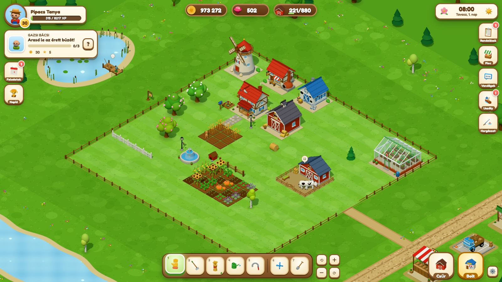
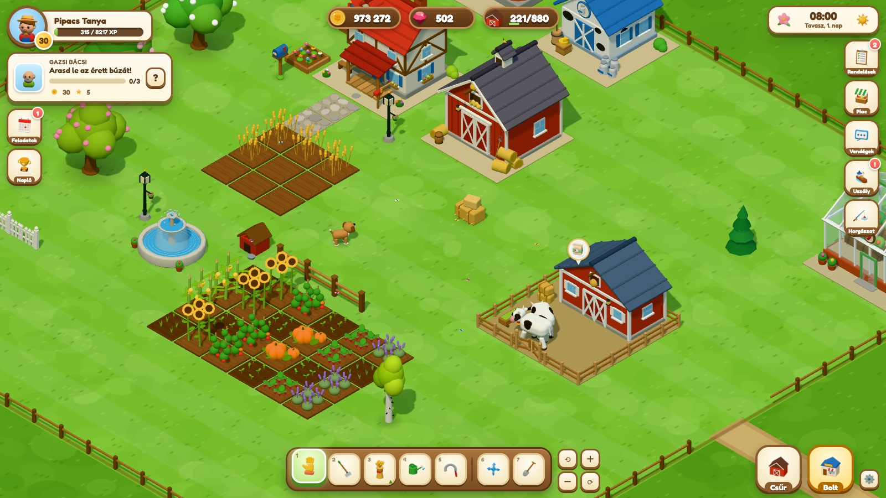
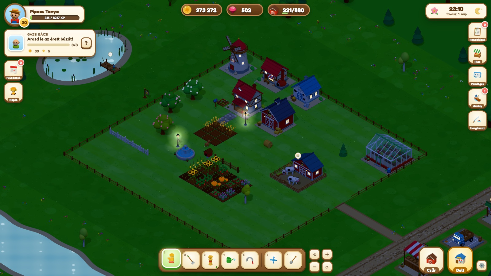
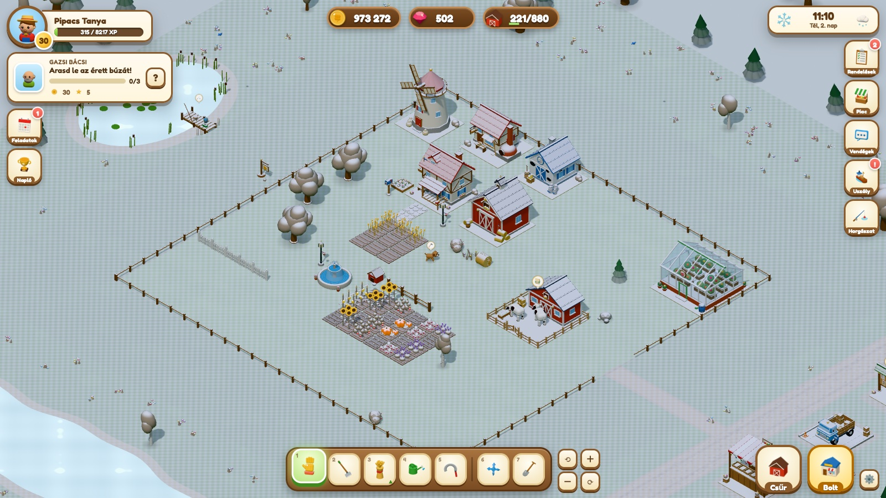
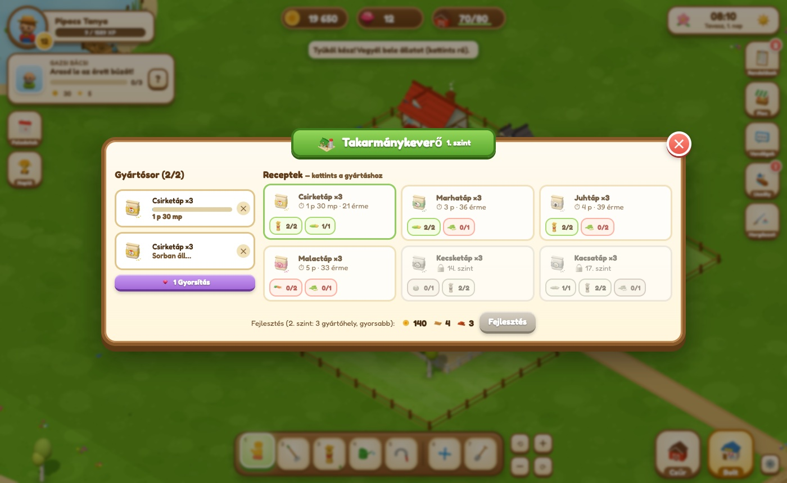
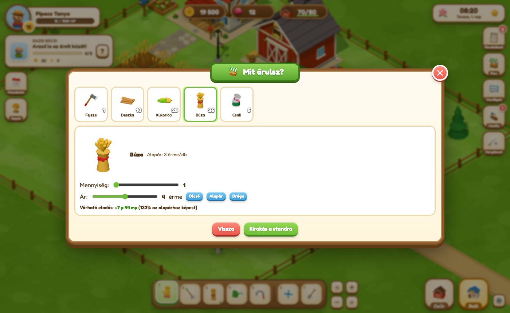
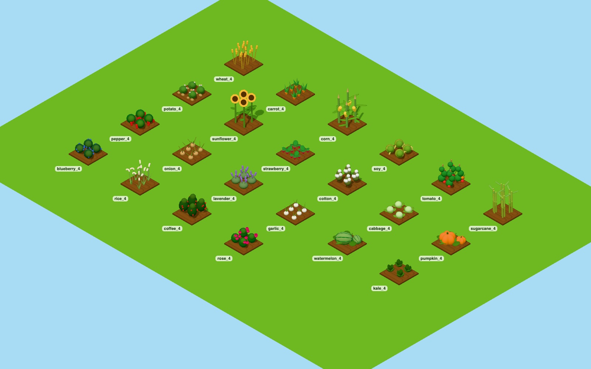
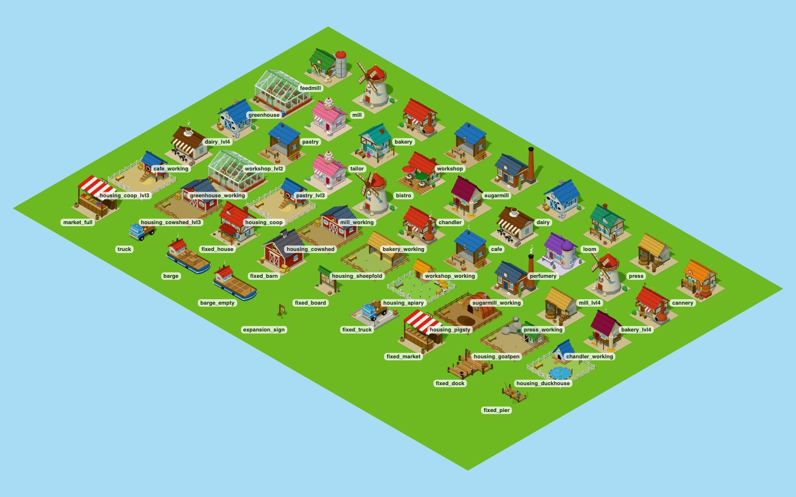

# Pipacs Tanya 3D

A cosy 3D farming game for the browser (original game in the classic browser-farm genre).
Built with Vite + vanilla JavaScript + Three.js; every model, icon and sound is procedural – there are no external assets.



| | |
| --- | --- |
|  |  |
|  |  |
|  |  |



## Run

```bash
npm install
npm run dev      # http://localhost:5173
npm run build    # production build into dist/
```

Model gallery (dev only): `http://localhost:5173/gallery.html?set=plants|animals|buildings|decos|items`.

## Gameplay

- **Fields**: plough, sow (22 crops), water, harvest. Crops have favourite **seasons** (out of season they grow slower). Rain waters fields automatically; sprinklers too.
- **Seasons, weather, day & night**: one in-game day = 24 real minutes, a season = 7 days. Snow in winter, autumn leaves, spring blossoms, rain/snow showers, fireflies at night.
- **Animals** live in housings (coop, cow shed, sheepfold, apiary, pigsty, goat pen, duck house): buy animals, feed them with feed from the **feed mill**, collect products, pet them daily (happy animals sometimes give double).
- **Production chains**: 16 buildings, 60+ recipes (flour → bread, milk → cheese, tomato + pepper + onion → lecsó, ...). Buildings and housings can be upgraded (more slots, faster work, more animals).
- **Trading**: order board + delivery truck, your own **market stall** with player-set prices (cheap sells fast, expensive sells slowly), **visitors** walking in from the road, the **river barge** with 6 crates and a big bonus.
- **Fishing** minigame at the pond (bait, bite timing, reeling with a catch zone; fish depend on season and time of day).
- **Obstacles & materials**: clear weeds, bushes, stumps, logs, rocks and boulders (axe/pickaxe) for wood and stone → planks and bricks in the workshop → farm expansions and upgrades.
- **Progression**: 80 levels, 47-step story quest chain with villagers (then generated quests), daily login streak, 3 daily tasks, 14 achievements with 3 tiers, crop mastery stars, decorations with charm bonus, pets (dog digs up treasure daily, cat boosts harvests).
- Offline progress, autosave to `localStorage`, save export/import.

## Controls

| Input | Action |
| --- | --- |
| Left click / tap | Smart action (harvest, water, feed, collect, open panel); click an empty field for the seed picker |
| Drag starting on a field | Repeat the same action across fields (sow, water, harvest, plough) |
| Drag on empty ground, right/middle drag, Space + drag | Pan the camera |
| Wheel / pinch | Zoom |
| Q / E, ⟲ ⟳ | Rotate the camera by 90° |
| 1–7 | Tools: hand, hoe, seeds, watering can, sickle, move, remove |
| B / I / O | Shop / barn / orders |
| R | Rotate while placing |
| WASD / arrows | Pan |
| Esc | Cancel / close |

## Code structure

| Path | Purpose |
| --- | --- |
| `src/data/content.js` | All content & balancing (crops, animals, buildings, recipes, decorations, fish, expansions) |
| `src/data/progression.js` | XP curve, quests, achievements, daily rewards/tasks, NPC names |
| `src/core/*` | Pure game rules: state & persistence, clock/seasons/weather, farm, ranch (animals + production), shop, trade, progress |
| `src/three/lib.js` | Shared 3D style kit: cached materials with wind sway, snow cover, season colours and night glow |
| `src/three/models/*` | Procedural models (plants, animals & villagers, buildings, decorations, items/icons) |
| `src/three/scene.js`, `terrain.js`, `world.js`, `fx.js`, `icons.js` | Camera & lighting, terrain & scenery, state → scene sync & animation, particles, icon rendering |
| `src/ui/*` | HUD, modals, fishing minigame, styles |
| `src/input.js`, `src/audio.js`, `src/main.js` | Input, synthesized audio, bootstrap & main loop |
